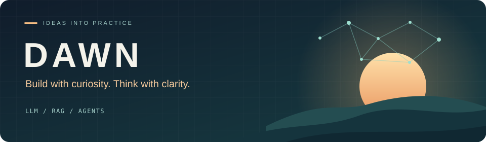

  

<h1 align="center">Hey there 👋, I'm DAWN</h1>

  <b>AI 工程师 · 大模型应用与智能体开发 · 终身学习者</b> 
  用原理驱动工程，用结构表达思考。

  
  
  

### Glad to see you here! 很高兴遇见你

我关注 **大模型应用、检索增强生成（RAG）与 AI Agent**，喜欢从原理出发，把想法变成可以运行、验证和持续改进的项目。

这里记录我的工程实践与学习过程：从文档理解和检索评测，到 Linux / C++ 基础，再到把人文与旅行兴趣做成小工具。希望每一次探索，都能留下清楚的思路和有用的作品。

---

### 🔭 What I'm exploring · 最近在探索

- **RAG 与文档理解**：多模态检索、长文档问答，以及检索质量如何影响最终回答。
- **Agent 工程**：框架机制、上下文组织与工具调用，让智能体更可靠地完成任务。
- **从实验到工程**：关注复现流程、评测与文档，把“能跑起来”推进到“能解释清楚”。
- **持续沉淀**：整理学习笔记与知识体系，保持对开源项目和前沿论文的好奇。

### 🛠 Languages & tools · 技术与工具

  
  
  
  
  
  

`LLM Applications` · `Retrieval-Augmented Generation` · `AI Agents` · `Evaluation`

### 📌 Projects & explorations · 项目与实践

| 项目 | 在这里探索什么 |
| :--- | :--- |
| 🧠 **[MoLoRAG](https://github.com/ac1269277935/MoLoRAG)** | 围绕开源 MoLoRAG 的多模态长文档检索与问答复现，整理中文复现指南与运行流程。 |
| 🏞️ **[山河印记 · 中国 5A 景区地图](https://github.com/ac1269277935/shanhe-scenic-atlas)** | 可离线打开的交互旅行图册，支持景区筛选、搜索定位、个人标记与备份。 |
| ⚙️ **[Linux WebServer](https://github.com/ac1269277935/Linux-webserver)** | 基于课程实践的 Linux / C++ Web 服务器，探索 I/O 多路复用、线程池与 HTTP 请求解析。 |

  <a href="https://github.com/ac1269277935?tab=repositories">查看全部仓库 →</a>

### ⚡ GitHub & beyond · 代码之外

  
<b>📊 GitHub activity · 展开查看</b>

   
  
  
统计图由第三方服务生成；如暂时无法加载，可直接查看主页下方的 GitHub 贡献记录。

  
<b>🌱 Beyond code · 我的兴趣一角</b>

- 围棋、认知科学与哲学思辨。
- 中国传统文化、历史人文与山河风物。
- 科技与财经观察，以及让生活更便利的数码和智能家居。

### 💬 Let's connect · 一起交流

欢迎交流 **RAG、Agent、文档理解、工程实践**，也欢迎分享有意思的开源项目。

可以在 [主页仓库发起 Issue](https://github.com/ac1269277935/ac1269277935/issues)，或在相关项目下讨论具体问题。

---

  <b>保持好奇，持续构建。</b> 
  Thanks for stopping by. If something here helps you, a ⭐ is always appreciated.

